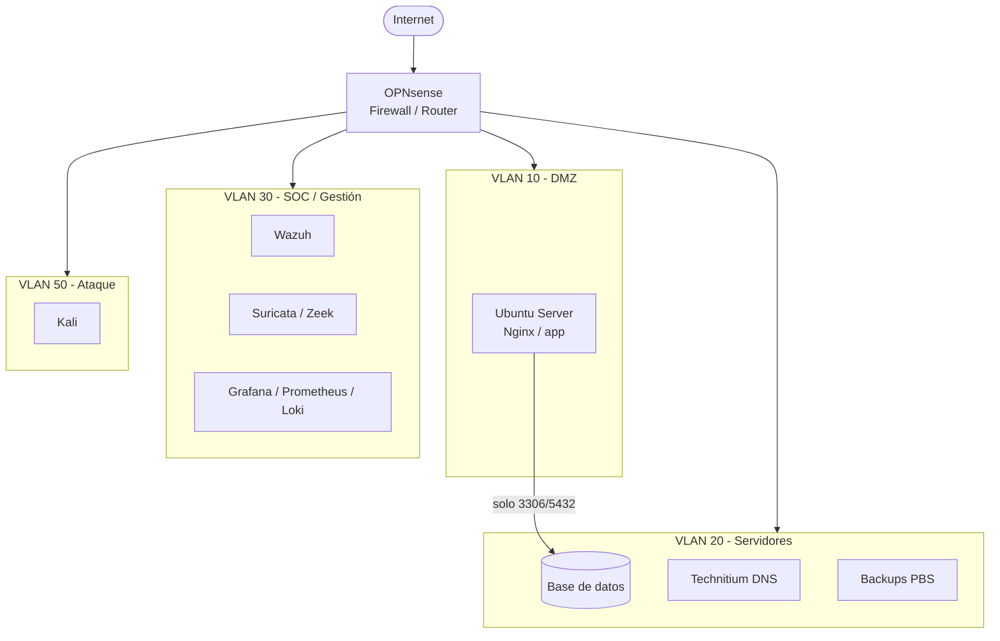

# Homelab de Ciberseguridad

Laboratorio de ciberseguridad sobre Proxmox VE con segmentación por VLAN,
SOC (Wazuh) y entorno de ataque aislado.

## Objetivos
- Aprender segmentación de redes con PFsense
- Montar un SOC de práctica
- Documentar todo el proceso

## Estado
- [X] Instalacion proxmox
- [X] PFsense + puentes
- [X] Ubuntu Server
- [ ] DMZ
- [ ] DNS
- [ ] Base de datos
- [ ] Wazuh y herramientas SOC
- [ ] Pruebas de vulnerabilidades

## Documentación
- [Instalación de Proxmox](docs/01-proxmox.md)
- [Gestion Bridge](docs/02-PFsense.md)
- [Levantar UBUNTU SERVER](docs/03-ubuntu_server.md)

