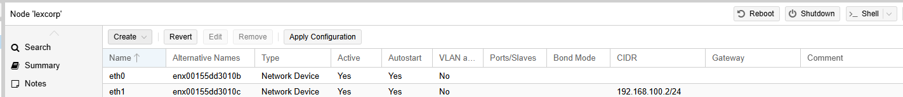
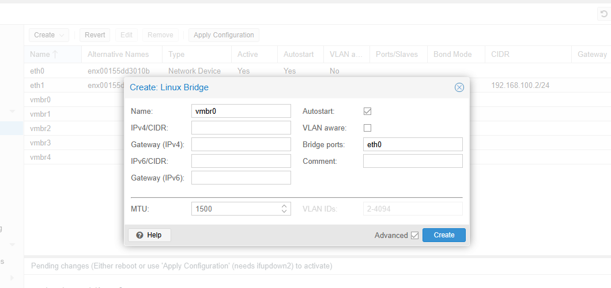
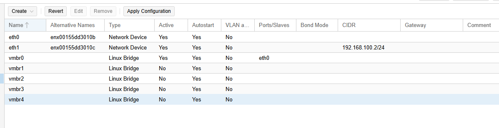
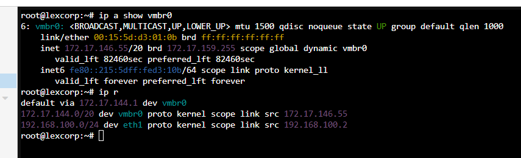

# Instalación de pfSense y segmentación con bridges
pfSense es un sistema operativo de red de código abierto basado en FreeBSD, diseñado para funcionar 
como firewall, enrutador y puerta de enlace de alta seguridad.
## Objetivos
- Creacion de puentes de red para las distintas MV, pfsense y poder dividir las redes
- Subir ISO de pfsense y crear MV
- Aplicar política de denegación por defecto entre zonas con reglas de pfSense

## Paso 1: Creacion de puente de red
Dentro de nuestra GUI, debemos seleccionar nuestro nodpo (lexcorp) vamos al apartado **Network** 
Ahi se nos mostrara los adaptadores de red, que en el apartado pasado contabamos con eth0 en DHCP
y eth1 estatico

Dentro de network elegimos la opcion Linux Bridge para crear un nuevo puente en total seran 5 nuevos:
vmbr0: Se usara para WAN y permitir el acceso a internet por medio de PFsense, debemos elegir en bridge port nuestro 
adaptador eth0.
Para el resto debemos dejarlos vacios.
vmbr1:Lo usaremos como DMZ, ahi alojaremos Ubuntu Server y nuestro servidor apache
vmbr2: Usado para administrar nuestros DNS con technitium asi como la BD y los respaldos
vmbr3: SOC, ahi dentro manejaremos las herramientas de seguridad Suricata, Zeek y Wazuh
vmbr4: Nuestra zona de guerra, ahi realizaremos pruebas de ataque con maquina de kali linux
El primer puente en la opcion de puertos eligiremos el adaptador eth0


Editamos el archivo interfaces cambiando el adaptador vmbr0 por DHCP, guardamos los cambios.
****
Dentro de la linea de comandos 
```
systemctl restart networking
ip a show vmbr0
ip r
```
El primer comando reinicia el servicio de red para confirmar que se aplicaron los cambios
ip a show **interfaz** nos permitira ver a detalle  la interfaz que especifiquemos, en este caso el primer puente que creamos
El comando ip r muestra las rutas que tenemos en el kernel, incluyendo el gateway por defecto, que como se muetra en la
siguiente imagen la interfaz coincide con vmbr0


