# Instalación de pfSense y segmentación con bridges
pfSense es un sistema operativo de red de código abierto basado en FreeBSD, diseñado para funcionar 
como firewall, enrutador y puerta de enlace de alta seguridad.
## Objetivos
- Creacion de puentes de red para las distintas MV, pfsense y poder dividir las redes
- Subir ISO de pfsense y crear MV
- Aplicar política de denegación por defecto entre zonas con reglas de pfSense

## Paso 1: Creacion de puente de red
Dentro de nuestra GUI, debemos seleccionar nuestro nodo (lexcorp) vamos al apartado **Network** 
Ahi se nos mostrara los adaptadores de red, que en el apartado pasado contabamos con eth0 en DHCP
y eth1 estatico

Dentro de network elegimos la opcion Linux Bridge para crear un nuevo puente en total seran 5 nuevos:
vmbr0: Se usara para WAN y permitir el acceso a internet por medio de PFsense, debemos elegir en bridge port nuestro 
adaptador eth0.
Para el resto debemos dejarlos vacios. 
vmbr1:Lo usaremos como DMZ, ahi alojaremos Ubuntu Server y nuestro servidor apache

vmbr2: Usado para administrar nuestros DNS con technitium asi como la BD y los respaldos

vmbr3: SOC, ahi dentro manejaremos las herramientas de seguridad Suricata, Zeek y Wazuh

vmbr4: Nuestra zona de guerra, ahi realizaremos pruebas de ataque con maquina de kali linux

El primer puente en la opcion de puertos eligiremos el adaptador eth0


Editamos el archivo interfaces cambiando el adaptador vmbr0 por DHCP, guardamos los cambios.
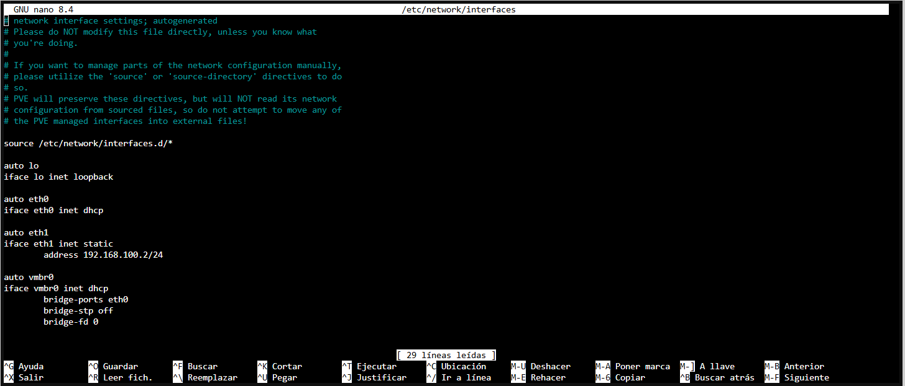
Dentro de la linea de comandos 
```
systemctl restart networking
ip a show vmbr0
ip r
```
El primer comando reinicia el servicio de red para confirmar que se aplicaron los cambios
ip a show **interfaz** nos permitira ver a detalle  la interfaz que especifiquemos, en este caso el primer puente que creamos
El comando ip r muestra las rutas que tenemos en el kernel, incluyendo el gateway por defecto, que como se muetra en la
siguiente imagen la interfaz coincide con vmbr0


## Paso 2: Carga de ISO y creacion maquina virtual pfsense
Para crear la mv de pfsense debemos descargar su ISO de la version comunidad con el siguiente link
```
https://www.pfsense.org/download/
```
Deberemos descomprimirlo, con vista server elegimos el nodo y despues nuestro apartado storage, ahi aparecerean varias opciones

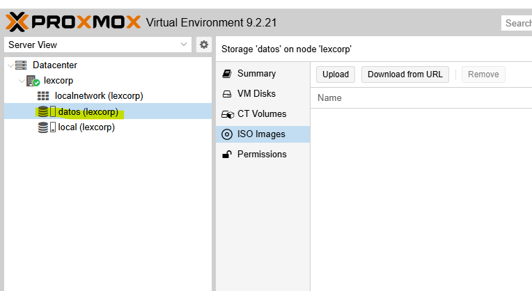

Elegimos la que venga como **ISO Image** y despues upload para cargar

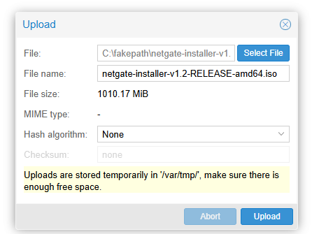

Nos aparecera para especificar algunos detalles, en OS, elegimos el lugar de almacenamiento, el archivo ISO que descomprimimos
elegimos otro al no ser linux, solaris o windows.
Sistema lo dejaremos por defecto
Avanzamos a Disk, con 16gb bastaran.
2 sockets y 1 core nos permitira que fluya bien, 2GB de ram y en **Network** seleccionaremos el puente antes mencionado vmbr0
y modelo VirtOI

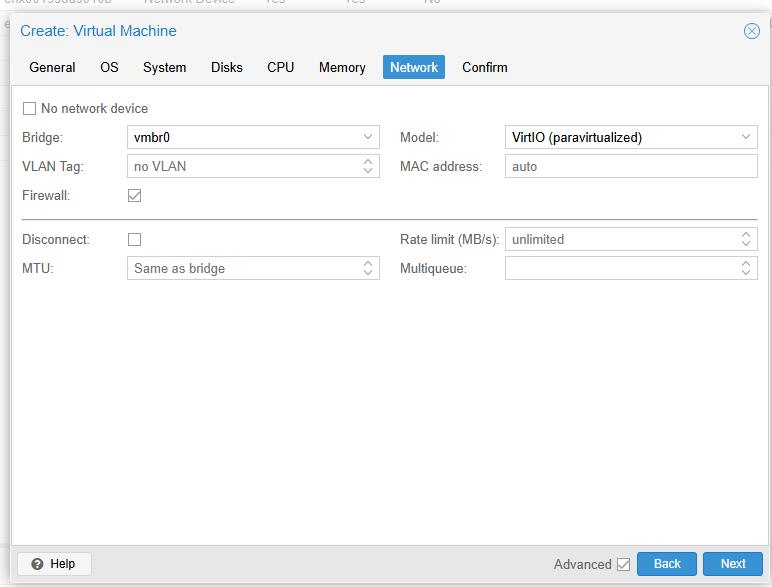

Nos quedar asi
Damos finish para terminar el proceso y del lado izquierdo debajo del nodo estara nuestra maquina virtual

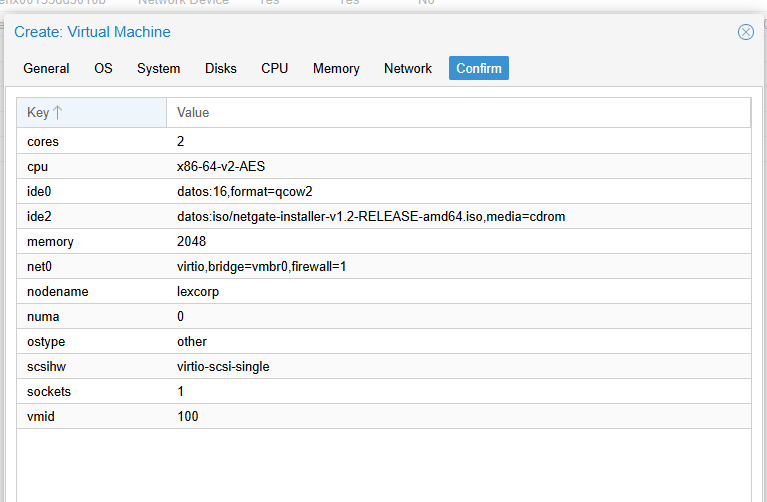

## Paso 3: Instalacion pfsense
Seleccionaremos la mv recien creada, damos play para que arranque.
Nos mostrara un mensaje de copyright, simplemente le daremos enter para aceptar.
En seguida aparecera un menu, damos enter a la opcion de **install pfsense**
A continuacion nos mostrara que adaptador seria opcion para WAN, unicamente nos aparecera el vmbr0 que anteriormente creamos

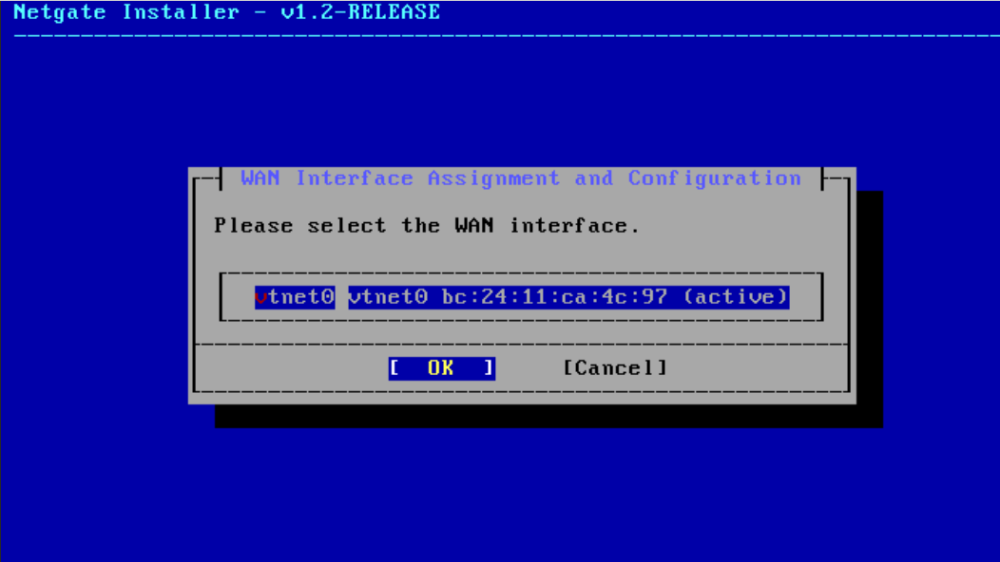

Avanzamos, y nos mostrara otro menu para elegir opcion de configuracion de la WAN
En este caso debemos dejarla por defecto
M es para modo interface o modo de interfaz
En este caso como se puede ver esta la opcion DHCP tal y como en nuestro adaptador
V Sirve para que la WAN envíe y reciba tráfico etiquetado con una VLAN, aun no contamos con VLAN
U Controla qué servidor DNS usa pfSense para sus propias consultas:

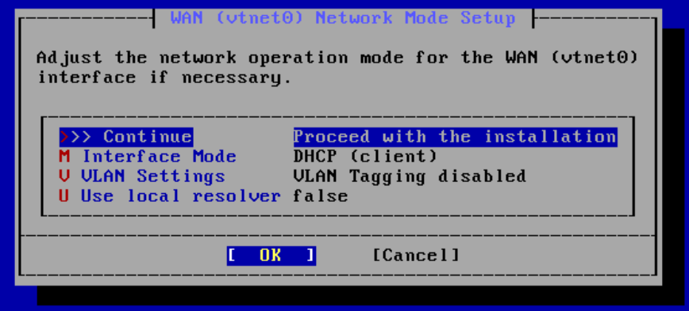

Damos en continuar y comenzara la instalacion, en este caso al no tener suscripcion usaremos la version CE o comunity.
Una vez terminada la instalacion debemos reiniciar la maquina virtual de pfsense.
A continuacion para añadir tarjetas de red las cuales seran correspondientes a los puentes antes creados.
Con la maquina apagada, seleccionamos el apartado **hardware**, luego **add** y seleccionamos **Network Device**

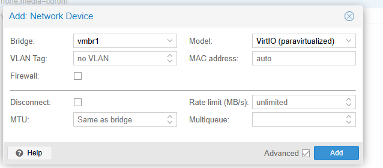 

Debemos desmarcar la casilla de **Firewall** y elegir modelo VirtIO

## Paso 4: configuracion Interfaces:
Despues de haber añadido las interfaces de red encendemos la maquina virtual de pfsense, nos va a mostrar un menu con varias opciones, elegimos la opcion 1 "Assign Interfaces" para 
configurar las interfaces que antes añadimos

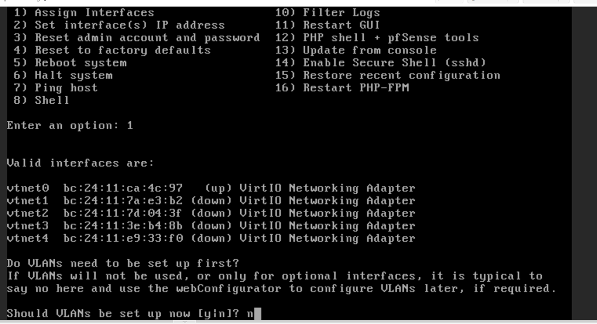 

Nos preguntara si se configuraran VLAN en este momento, no es necesario daremos que no ya que usamos puentes de Red.
Despues nos mostrara las opciones que tenemos de interfaces. Debemos elegir una como WAN, que seria la opcion 1 vtnet0 que anteriormente configuramos con DHCP para que nos diera salida a internet.
A continuacion nos pedira una como LAN, elegiremos la vtnet1

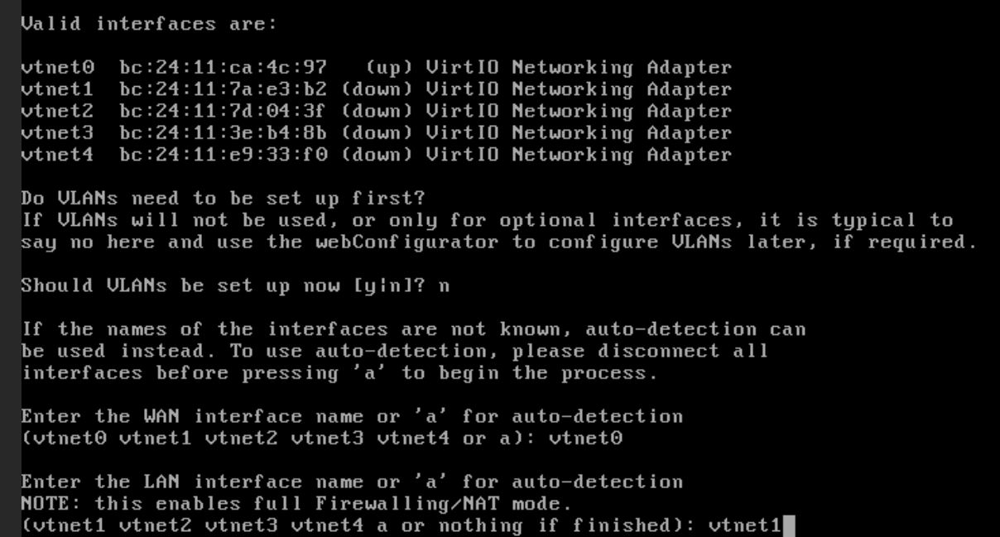 

Para las otras 3 VLAN que configuramos las asignaremos como opcionales, con el fin de tenerlas como subredes aisladas
## Paso 5: Configuracion IP

Volviendo al menu principal de pfsense seleccionamos la opcion 2 "Set interface IP address" para asignar direcciones rangos de IP a nuestras interfaces
Veremos las opciones de interfaces que tenemos apra configurar, nos preguntara si la queremos por DHCP, el rango y mascara de subred que el daremos, si tendra IPv6 y al final la direccion para configuracion web

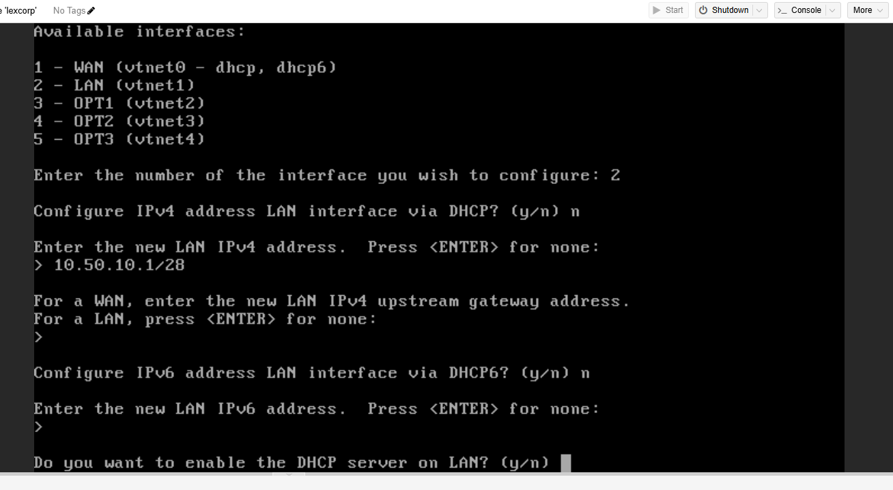

Configuradas todas las IP nos aparecera algo como esto

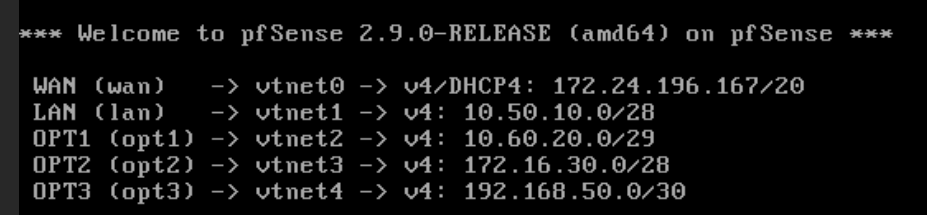 

## Paso 6: Maquina de prueba
Antes de pasar a levantar servicios debemos verificar que la configuracion de las interfaces es correcta y nos permite comunicacion.
Creamos una nueva maquina virtual con debian, dentro de esta vamos modificar el archivo intefaces.
Revisamos el nombre de nuestra interfaz dentro de linux con:
``
ip a
``
Nos arrojara el nombre y la configuracion actual, pasamos a la siguiente ruta
``
sudo nano /etc/networking/interfaces
``
Dentro colocamos la direccion ip que este dentro del rango de la interfaz y el gatway que seria:

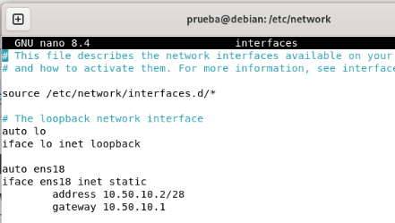

Luego de modificar reiniciamos el servicio

``
sudo systemctl restart networking
``

Para verificar que este funcionando hacemos

``
ip a # veremos nuestras interfaces nuevamente para confirma que coincide con la modificacion
``
``
ping -c 4 10.50.10.1 # confirmar que nuestro gateway responde
``
``
ping -c 4 8.8.8.8 # confirmar que tenemos internet
``

Probamos por ultimo la GUI con la direccion que nos dio pfsense en un inicio, nos dara alerta de conexion insegura tal como proxmox
Para ingresar por default las credenciales son 
Admin
pfsense
debera verse asi al entrar:

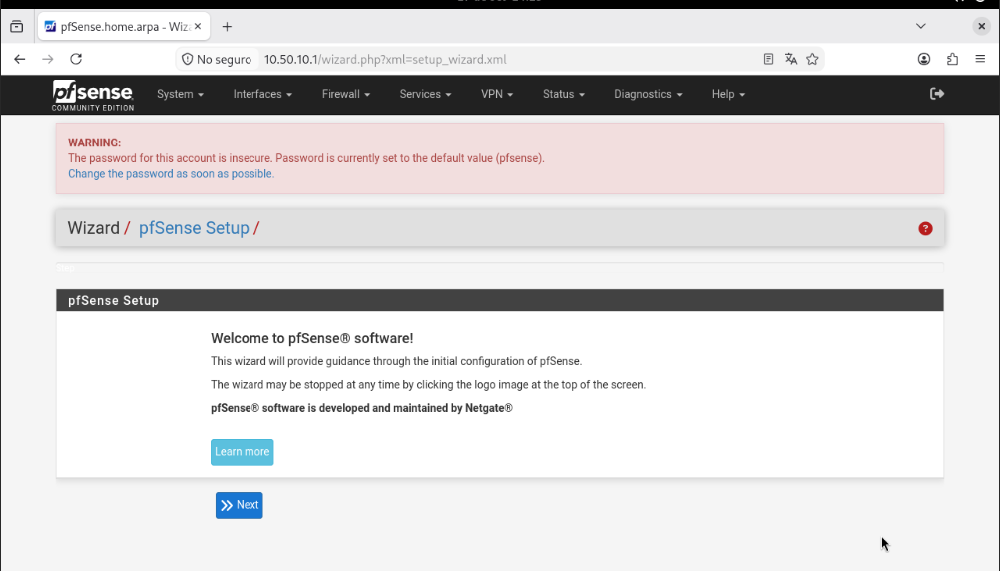


