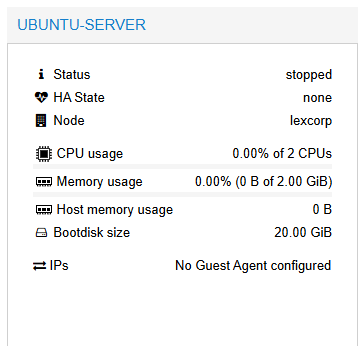
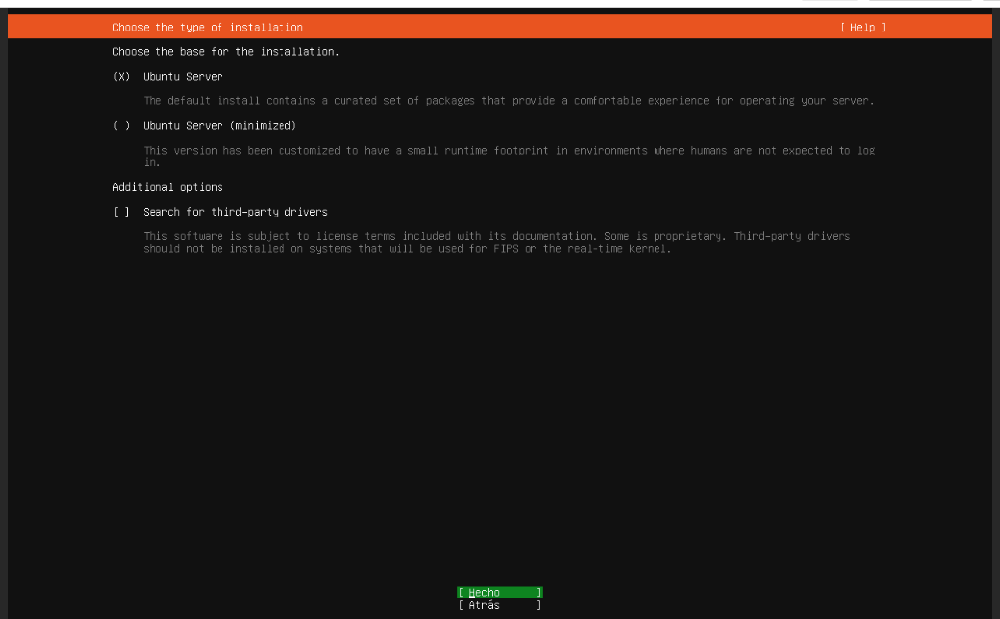
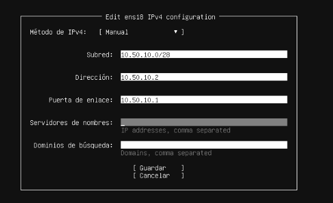
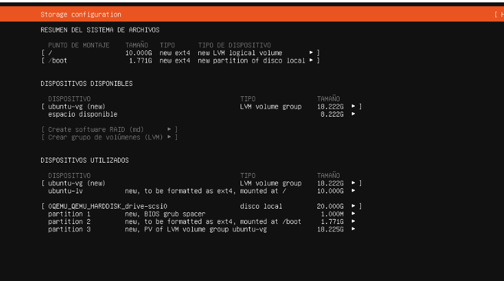
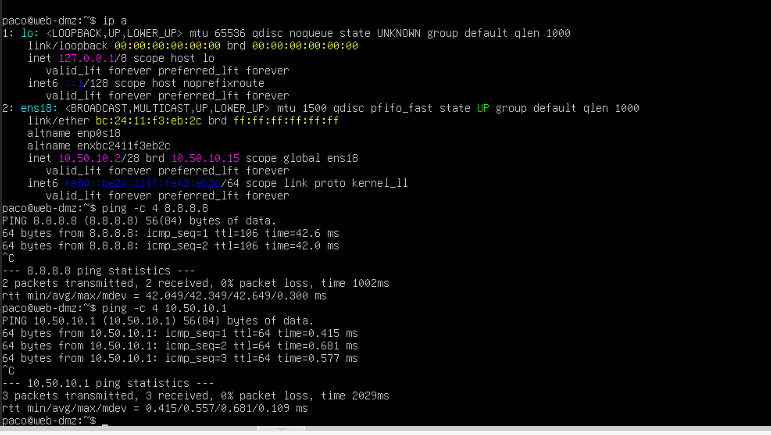

# Ubuntu Sever LTS

Ubuntu Server es una versión del sistema operativo libre y de código abierto Ubuntu (desarrollado por Canonical), diseñada específicamente 
para funcionar en ordenadores y entornos que actúan como servidores.

## Objetivos
- Descargar ubuntu server LTS
- Configurar ubuntu server
- Probar conexion de red

## Paso 1: Creacion maquina virtual
Repetimos el proceso para la creacion de la maquina virtual que hicimos con pfsanse usando el ISO de ubuntu server LTS, ese ISO lo descargamos en:
````
http://ubuntu.com/download/server
````

Debe tener estas especificaciones:



## Paso 2: Configuracion Ubuntu
Al correr la maquina recien creada nos apareceran los tipicos inicia al arrancar linux.
-idioma
-teclado
un punto importante es que nos mostrara el tipo de instalacion:



Elegimos el primer tipo de instalacion al contener todo lo necesario.
Posterior a eso nos aparecera para configurar la interfaz, colocamos el gateway, ip, la subred y por ahora dejamos como 8.8.8.8 los DNS



Lo siguiente es el disco lo dejamos por defecto



## Paso 3: Arranque
Una vez terminemos la configuracion inicial nos mostrara la terminal.

Aqui debemos validar que se tiene respuesta en red usamos los siguientes comandos:
````
ip a #para confirmar que la ip asignada coincide con la que nos muestra
````
````
ping -c 4 8.8.8.8 #para ver si tenemos respuesta hacia internet
````
````
ping -c 4 10.60.20.1 #para confirmar respuesta de gateway que seria la asignada a la interfaz en pfsense documento anterior
````


