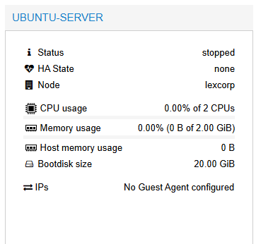
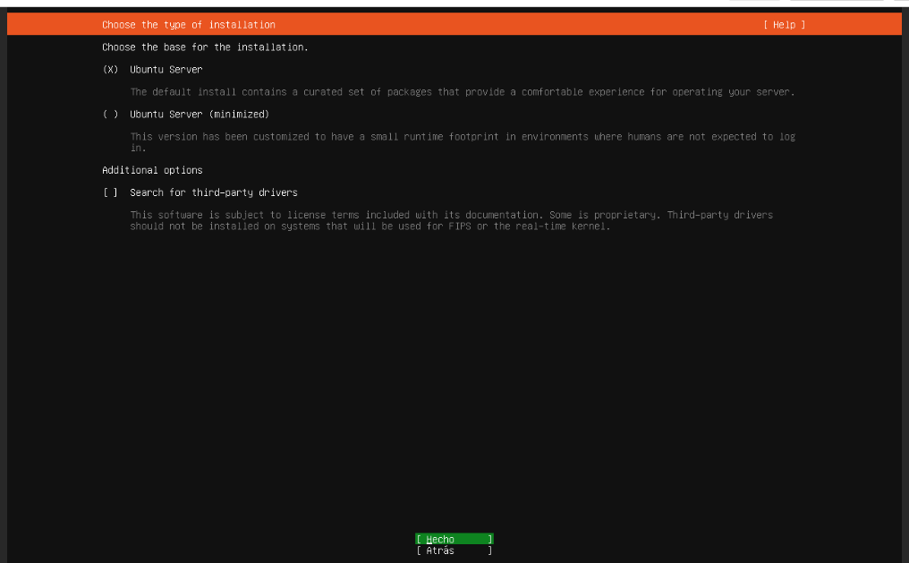
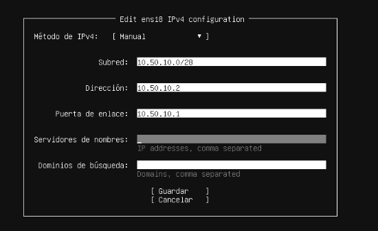
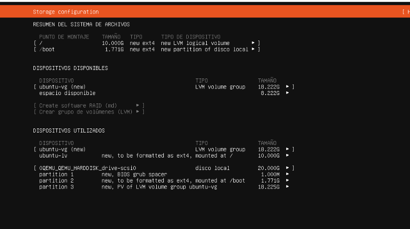

# Creacion de Pagina web Apache

Es uno de los servidores web gratuitos y de código abierto más populares y utilizados en el mundo. Su funcion es la administracion de solicitudes de usuarios entre sitios web y navegadores.

## Objetivos
- Levantar el servicio web
- Añadir Proxy reverso para mayor seguridad
- Lograr acceso a la web

## Paso 1: Preparacion maquina virtual
Lo primero es preparar la pagina web actualizando nuestra mv de ubuntu server:
````
sudo apt update
````
````
sudo apt upgrade
````

Debe tener estas especificaciones:



## Paso 2: Configuracion Ubuntu
Al correr la maquina recien creada nos apareceran los tipicos inicia al arrancar linux.
-idioma
-teclado
un punto importante es que nos mostrara el tipo de instalacion:



Elegimos el primer tipo de instalacion al contener todo lo necesario.
Posterior a eso nos aparecera para configurar la interfaz, colocamos el gateway, ip, la subred y por ahora dejamos como 8.8.8.8 los DNS



Lo siguiente es el disco lo dejamos por defecto


