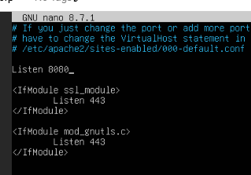
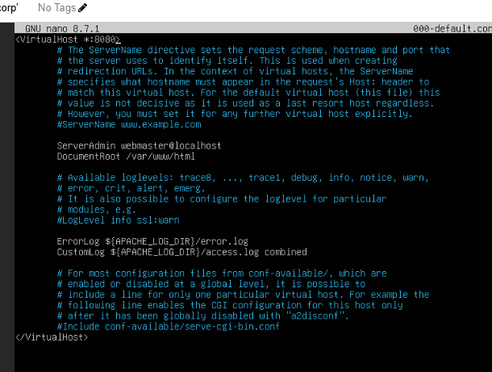
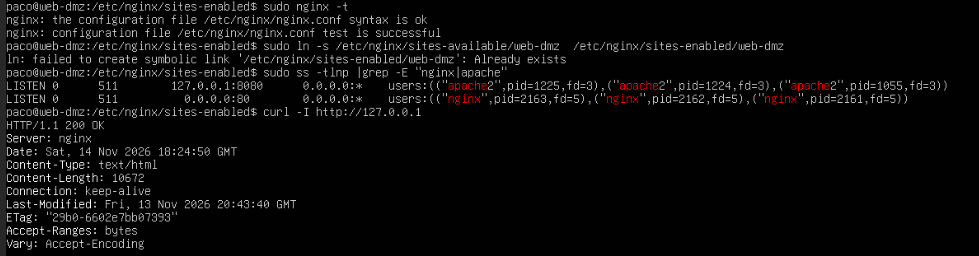
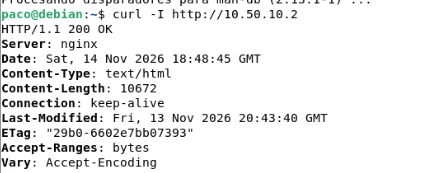
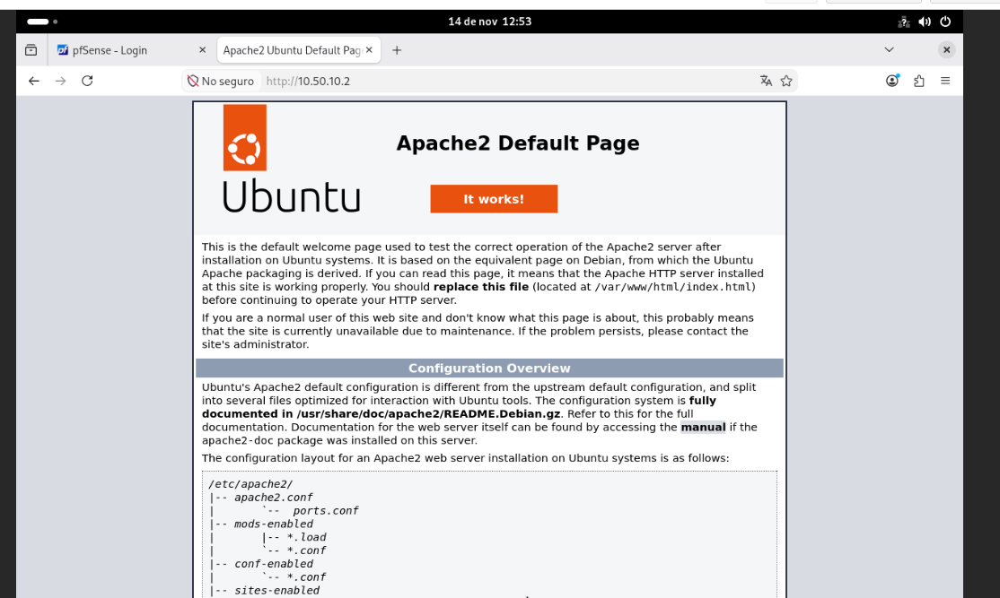
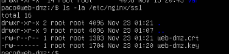
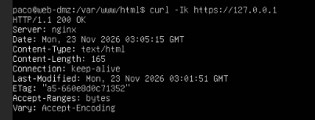
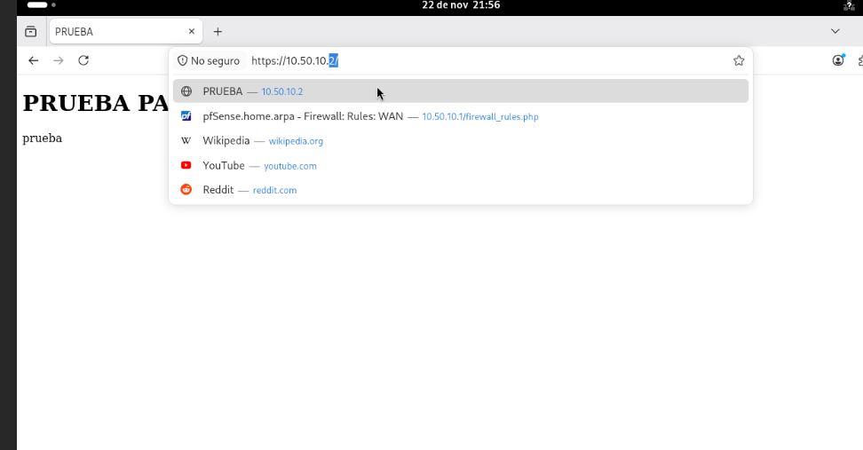

# Creacion de Pagina web Apache

Es uno de los servidores web gratuitos y de código abierto más populares y utilizados en el mundo. Su funcion es la administracion de solicitudes de usuarios entre sitios web y navegadores.

## Objetivos
- Levantar el servicio web
- Añadir Proxy reverso para mayor seguridad
- Lograr acceso a la web

## Paso 1: Instalacion de apache2
Lo primero es tener todo bien actualizado:
````
sudo apt update 
````
````
sudo apt upgrade
````

Posterior a eso necesitamos instalar la paqueteria necesaria usamos:
````
sudo apt install apache2 
````
Terminada la instalacion usamos para ver que este ya se encuentra activo
````
systemctl status apache2
````
Posterior a eso debemos modificar el puerto ya que quien manejaria las peticiones seria nuestro proxy inverso.
Dentro de /etc/apache modificamos el archivo "ports.conf" debe quedar asi:



Igual iremos a /etc/apache/sites-availables/ y modificaremos el archivo "000-default.conf" 



Modificamos a puerto 8080 porque el puerto 80 que recibira las peticiones sera nginx pero eso lo veremos mas adelante.
Reiniciamos el servicio para que se vea reflejado.

## Paso 2: Instalacion NGINX
Como se menciono al inicio de este documento, se añadira un proxy inverso para generar mas seguridad, como tal los proxy inversos funcionan como "intermediarios" recibiendo las peticiones y reenviandolas a los servidores internos, siendo el NGINX el unico punto de contacto.
````
sudo apt install nginx -y 
````


## Paso 3: Creacion de sitio en NGINX
Vamos a "/etc/nginx/sites-available" y creamos el archivo "web-dmz"
Dentro de este colocamos el siguiente texto:
````
server {
    listen 80;
    server_name _;

    server_tokens off;

    location / {
        proxy_pass http://127.0.0.1:8080;
        proxy_set_header Host $host;
        proxy_set_header X-Real-IP $remote_addr;
        proxy_set_header X-Forwarded-For $proxy_add_x_forwarded_for;
        proxy_set_header X-Forwarded-Proto $scheme;
    }
}
````
La primer linea es encargada de iniciar el archivo de configuracion

Listen 80 indica que puerto escuchara

server_name con el guion se usa como comodin para que atienda cualquier peticion que llegue

Server_tokens off hace que al dar peticiones web  no se muestre la version del nginx esto lo mostraremos mas adelante

Location / define el bloque de locacion y la diagonal se usa para peticiones que entren en raiz del sitio como "/contacto, /productos, /inicio" etc.

proxy_passs es usado para manejar las peticiones, ordena que tome la peticion y se la pase a apache por 8080 enviandola internamente, apache procesa la peticion y regresa la respuesta a nginx para que este la entregue al usuario.

Proxy_set_header host  funciona como intermediario, por defecto podría pasarle a Apache un encabezado Host genérico. Esta línea le transmite a Apache el dominio o IP original que el usuario escribió en su navegador (almacenado en la variable $host).

proxy_set_header X-Real-IP añade una cabecera con ese nombre, dado a que nginx es la unica conexion que conoce apache, esa cabecera contiene la IP real del cliente.

X-Forwarded-For es similar a la anteriro

X-Forwarded-Proto le informa a apache que protocolo utilizo el usuario para conectarse, como SSL que mas adelante configuraremos.

Despues para confirmar que se guarden los cambios recargamos el servicio

````
sudo systemctl reload nginx
````
Despues de reiniciar el servicio para confirmar que la sintaxis es correcta y que los servicios operan correctamente usaremos
````
sudo nginx -t
````
````
sudo ln -s /etc/nginx/sites-available/web-dmz /etc/nginx/sites-enabled/web-dmz
````
````
sudo ss -tlnp | grep -E "nginx|apache"
````
````
curl -I http://127.0.0.1
````


El primer comando es para revisar la sintaxis de nginx, al estar todo correcto nos arroja un OK

El seguno es para crear un enlace simbolico entre las carpetas available y enabled, esto se usa para tener la configuracion real a aparte,evitando errores humanos o de requerirse mantenimiento solo suspender el enlace.

Despues ss nos muestra los procesos activos de nginx y de apache, como se puede ver apache solo escucha en puerto 8080 a local host(127.0.0.1) y nginx escucha todo en 80.

Por ultimo la peticion web tal como se menciono en server_tokets off, no se muestra la version de este, y al estar activo es quien responde las peticiones no apache.

## Paso 4: Validacion 

Pasamos a la maquina virtual donde hacemos pruebas, dentro de esta intentaremos neuvamente peticiones web:



Nos respondera igual con los datos de la peticion web, despues vamos al navegador y nos arrojara el apache


## Paso 5: CERTIFICADOS
Lo siguiente es añadir SSL para volver mas seguro nuestro sitio.
Dentro de /etc/nginx creamos el directorio SSL
````
sudo mkdir /etc/nginx/ssl
````
Tendremos el directorio donde guardaremos el certificado poara darle proteccion a la pagina.
Lo siguientes sera generar un certificado autofirmado y clave privada

````
sudo openssl req -x509 -nodes -days 365 -newkey rsa:2048 -keyout /etc/nginx/ssl/web-dmz.key -out /etc/nginx/ssl/web-dmz.crt
````
Este comando hace que con la herramienta openssl se genere certificados  X.509, "-x509" genera directamente con autofirmado.
nodes o no DES evita que usemos contraseña manual cada vez.
day 365 como su nombre lo dice por 365 dias tendremos validez.
rsa:2048 nos genero la clave con RSA DE 2048 BITS
KEYOUT guarda la clave privada en la ruta mostrada
OUT guarda la clave publica en la ruta mostrada
Para verificar que se guardaron los certicados hacemos ssl a /etc/nginx/ssl verificando que este web-dmz.crt y web-dmz.key


## Paso 6: PUERTO 443
En el paso 3, se mostro el archivo de configuracion original el cual abriamos el puerto 80 para que nginx recibiera peticiones y las redirigiera a 8080 para que las manejara APACHE
con el HTTPS quedara un poco distinto.
vamos a /etc/nginx/sites-available y modificamos el archivo web-dmz

````
server {
    listen 80;
    server_name _;
    server_tokens off;
    return 301 https://$host$request_uri;
}

server {
    listen 443 ssl;
    server_name _;

    server_tokens off;

    ssl_certificate /etc/nginx/ssl/web-dmz.crt;
    ssl_certificate_key /etc/nginx/ssl/web-dmz.key;

    location / {
        proxy_pass http://127.0.0.1:8080;
        proxy_set_header Host $host;
        proxy_set_header X-Real-IP $remote_addr;
        proxy_set_header X-Forwarded-For $proxy_add_x_forwarded_for;
        proxy_set_header X-Forwarded-Proto $scheme;
    }
}
````
return 301 es redireccion permanente, $host conserva el dominio/ip y $request_uri conserva la ruta y parametros como /inndex.html o /login
en el segundo bloque tiene  ssl_certificate /etc/nginx/ssl/web-dmz.crt; 
para buscar la llave publica y ssl_certificate_key /etc/nginx/ssl/web-dmz.key; a la privada

## Paso 7: Confirmacion en navegador

Una vez modificado el archivo de configuracion reiniciamos el servicio para que se apliquen los cambios y tiramos peticion con CURL

````
curl -Ik https://127.0.0.1
````

Mostrandonos este resultado



y vamos a ir a nuestra MV de prueba, buscamos

````
http://10.50.10.2
````
por defecto cambiara el http por https pero al ser autofirmado igual nos mostrara el mensaje de no seguro

