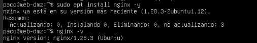

# Creacion de Pagina web Apache

Es uno de los servidores web gratuitos y de código abierto más populares y utilizados en el mundo. Su funcion es la administracion de solicitudes de usuarios entre sitios web y navegadores.

## Objetivos
- Levantar el servicio web
- Añadir Proxy reverso para mayor seguridad
- Lograr acceso a la web

## Paso 1: Instalacion de apache2
Lo primero es tener todo bien actualizado:
````
sudo apt update 
````
````
sudo apt upgrade
````

Posterior a eso necesitamos instalar la paqueteria necesaria usamos:
````
sudo apt install apache2 
````
Terminada la instalacion usamos para ver que este ya se encuentra activo
````
systemctl status apache2
````
Posterior a eso debemos modificar el puerto ya que quien manejaria las peticiones seria nuestro proxy inverso.
Dentro de /etc/apache modificamos el archivo "ports.conf" debe quedar asi:


Igual iremos a /etc/apache/sites-availables/ y modificaremos el archivo "000-default.conf" 


Modificamos a puerto 8080 porque el puerto 80 que recibira las peticiones sera nginx pero eso lo veremos mas adelante.
Reiniciamos el servicio para que se vea reflejado.

## Paso 2: Instalacion NGINX
Como se menciono al inicio de este documento, se añadira un proxy inverso para generar mas seguridad, como tal los proxy inversos funcionan como "intermediarios" recibiendo las peticiones y reenviandolas a los servidores internos, siendo el NGINX el unico punto de contacto.
````
sudo apt install nginx -y 
````



## Paso 3: Creacion de sitio en NGINX
Vamos a "/etc/nginx/sites-available" y creamos el archivo "web-dmz"
Dentro de este colocamos el siguiente texto:
````
server {
    listen 80;
    server_name _;

    server_tokens off;

    location / {
        proxy_pass http://127.0.0.1:8080;
        proxy_set_header Host $host;
        proxy_set_header X-Real-IP $remote_addr;
        proxy_set_header X-Forwarded-For $proxy_add_x_forwarded_for;
        proxy_set_header X-Forwarded-Proto $scheme;
    }
}
````
Y reeiniciamos el servicio con:
````
sudo systemctl restart nginx
````
Para confirmar que esta activado nginx y apache escuchando en su respectivo puerto usamos
````
sudo ss -tlnp | grep -E "nginx|apache"
````
Aparecera activos los siguientes procesos


Por ultimo hacemos una peticion web que nos respondera nginx


